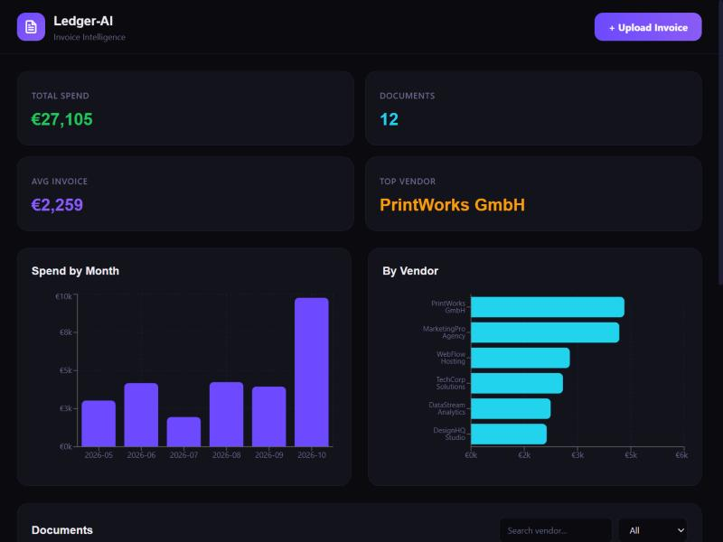

# Ledger-AI — Invoice Data Extractor

> AI-powered invoice processing with automatic data extraction and analytics, built by [Zolentix](https://zolentix.com)



## Features

- **Invoice Upload** — Drag-and-drop PDF/image invoice upload
- **AI Extraction** — Automatic vendor, date, amount, and line-item parsing
- **Document Library** — Browse, search, and filter processed invoices
- **Analytics Dashboard** — Spending trends, top vendors, monthly breakdowns with Recharts
- **Export** — Download extracted data as CSV
- **Status Tracking** — Processing, verified, and flagged document states

## Tech Stack

- **Framework:** Next.js 14 (App Router)
- **Language:** TypeScript
- **Styling:** Tailwind CSS
- **Charts:** Recharts
- **Database:** Prisma ORM + SQLite
- **Fonts:** Space Grotesk + Inter

## Getting Started

```bash
npm install
npx prisma db push
npx prisma db seed
npm run dev
```

Open [http://localhost:3000](http://localhost:3000) to view the dashboard.

## License

MIT — [Zolentix](https://zolentix.com)
